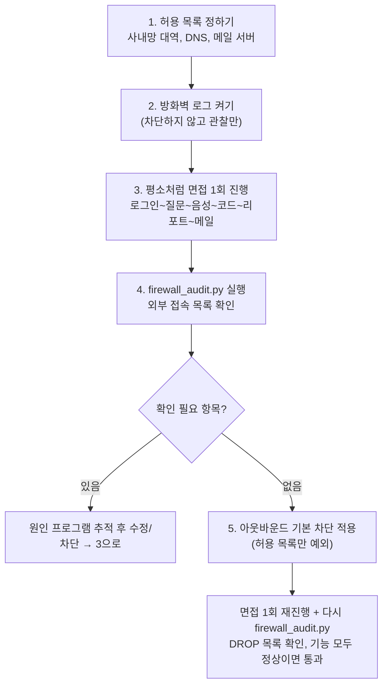

# 방화벽 아웃바운드 점검 절차 (온프리미스)

- 목적: 코드를 모두 고쳐도 숨은 외부 접속(라이브러리 자동 다운로드·업데이트 확인 등)이 남아 있지 않은지 **방화벽 로그로 증거**를 확보한다.
- 대상: **서버 PC**(백엔드·워커·LLM·DB가 도는 PC)와 **클라이언트 PC**(면접자·채용담당자가 쓰는 PC).
- **처리 제외: 메일(SMTP) 외부 발송.** 지원자에게 가는 안내 메일은 반드시 외부로 나가야 하므로 Gmail 발송을 유지하고 메일 서버만 예외로 허용한다.
- 이 문서의 Windows 명령어는 일반적인 방법이며 **이 서버(클라우드)에서 실행해 확인하지 않았다.** 첫 적용은 관리자 PowerShell에서 한 줄씩 실행하며 확인한다.

## 비유
건물 출입문이다. 보통은 밖에서 들어오는 사람을 막지만(인바운드), 여기서는 **안에서 밖으로 나가는 사람(아웃바운드)** 을 기록하고 막는다. 직원(프로그램)이 몰래 밖으로 전화하는지 출입 기록으로 확인하는 것이다.



## 0. 사전 준비
- 관리자 PowerShell 사용, 원격 접속 중이라면 **차단 전에 원격접속 허용 규칙을 먼저** 만든다(5단계 경고 참고).
- 파이썬이 있는 PC에서 `scripts/onprem/firewall_audit.py`를 복사해 실행한다(표준 라이브러리만 사용).

## 1. 허용 목록 정하기
| 항목 | 예시 | 비고 |
|---|---|---|
| 사내망 대역 | 10.0.0.0/8, 172.16.0.0/12, 192.168.0.0/16 | 기본으로 "내부"로 분류됨. 사설 대역이 아닌 사내 대역은 `--internal`로 추가 |
| 이 PC 안(루프백) | 127.0.0.1 | 백엔드↔LLM(8091)·DB(5544)·Redis(6389) 통신, 자동 내부 |
| DNS 서버 | 사내 DNS IP | 차단 시 이름 해석이 막히지 않게 |
| 원격접속 | RDP(3389) 등 | 차단 시 접속이 끊기지 않게 |
| **메일 서버(처리 제외)** | `smtp.gmail.com` 587 | 아래 "메일 서버 주소 주의" 참고 |

**메일 서버 주소 주의:** Gmail의 IP는 고정이 아니고 바뀔 수 있다. 방화벽에 IP로 예외를 만들면 어느 날 메일이 막힐 수 있다. 확인된 IP 대역을 `--allow-mail`에 넣어 분석하고, 방화벽 규칙은 정기적으로 점검하거나 사내 프록시/메일 릴레이를 두는 방법을 검토한다(이 항목은 조직 네트워크 정책에 따라 달라지며 이번 작업에서 결정하지 않았다).

## 2. 방화벽 로그 켜기 (차단 없이 관찰)
관리자 PowerShell:
```powershell
Set-NetFirewallProfile -Profile Domain,Private,Public -LogAllowed True -LogBlocked True `
  -LogFileName "%SystemRoot%\System32\LogFiles\Firewall\pfirewall.log" -LogMaxSizeKilobytes 16384
```
- 로그 파일은 기본적으로 꺼져 있다. 위 명령으로 허용(ALLOW)과 차단(DROP) 접속을 모두 기록한다.
- 로그 크기 상한(16MB)을 넘으면 오래된 기록이 덮어써지므로, 관찰 구간은 면접 1회 정도로 짧게 한다.

## 3. 면접 1회를 평소처럼 진행
로그인 → 면접 시작 → 음성 답변 → 코드 에디터 → 화이트보드·웹캠 → 리포트 생성 → 합격/불합격 안내 메일까지 전 과정을 진행한다. **클라이언트 PC에서도** 같은 화면을 돌려 본다(코드 에디터가 인터넷을 요구하지 않는지 포함).

## 4. 분석 도구 실행
```powershell
python firewall_audit.py "C:\Windows\System32\LogFiles\Firewall\pfirewall.log" --allow-mail 142.250.0.0/15:587
echo $LASTEXITCODE
```
| 종료코드 | 의미 | 할 일 |
|---|---|---|
| 0 | 메일 서버 외 외부 접속 없음 | 5단계로 |
| 1 | 확인 필요한 외부 접속 있음 | 목록의 목적지를 쓰는 프로그램을 찾아 원인 확인(해당 시각의 워커/백엔드 로그 대조), 수정 후 3단계 반복 |
| 2 | 로그 없음/형식 오류 | 로그가 켜져 있는지, 관리자 권한인지, 면접을 진행한 뒤인지 확인 |

- 결과 표의 `ALLOW`는 실제로 밖으로 나간 것, `DROP`은 차단됐지만 시도가 있었던 것이다.
- 사설 대역이 아닌 사내 대역(예: 100.64.0.0/10)은 `--internal 100.64.0.0/10`으로 추가한다.
- 도구가 읽는 로그 형식은 공개된 `pfirewall.log` 형식(`#Fields:` 줄 기준)이며, 실제 PC 로그와 형식이 다르면 종료코드 2와 안내가 나온다. 그 경우 로그 앞부분 몇 줄을 알려주면 보정한다.

## 5. 아웃바운드 기본 차단 적용 (4단계에서 0이 나온 뒤에만)
> **경고:** 허용 규칙 없이 기본 차단을 켜면 서버 접속(원격 데스크톱 포함)이 끊길 수 있다. 반드시 아래 허용 규칙을 먼저 만들고, 가능하면 서버 앞에 직접 앉아 있을 때 적용한다.

허용 규칙(예시, 환경에 맞게 수정):
```powershell
# 사내망 대역 허용
New-NetFirewallRule -DisplayName "OnPrem-Allow-Internal" -Direction Outbound -Action Allow `
  -RemoteAddress 10.0.0.0/8,172.16.0.0/12,192.168.0.0/16
# 메일 서버 허용 (처리 제외 항목: 메일 발송 유지) — IP/대역은 실제 값으로 교체
New-NetFirewallRule -DisplayName "OnPrem-Allow-Mail" -Direction Outbound -Action Allow `
  -Protocol TCP -RemotePort 587 -RemoteAddress 142.250.0.0/15
```
차단 적용:
```powershell
Set-NetFirewallProfile -Profile Domain,Private,Public -DefaultOutboundAction Block
```
이후 3단계(면접 1회 전 과정)와 4단계를 다시 수행한다. **통과 기준:** 모든 기능이 정상 동작하고, 4단계 결과의 확인 필요 항목이 없거나 예상한 것뿐이다.

**롤백(문제 시 즉시):**
```powershell
Set-NetFirewallProfile -Profile Domain,Private,Public -DefaultOutboundAction Allow
```

## 6. 결과 기록
점검 일시, 대상 PC(서버/클라이언트), 도구 출력, 종료코드, 조치 내용을 작업 로그에 남긴다. 메일 서버 접속이 로그에 있는 것은 정상이며 점검 제외 대상이다.
