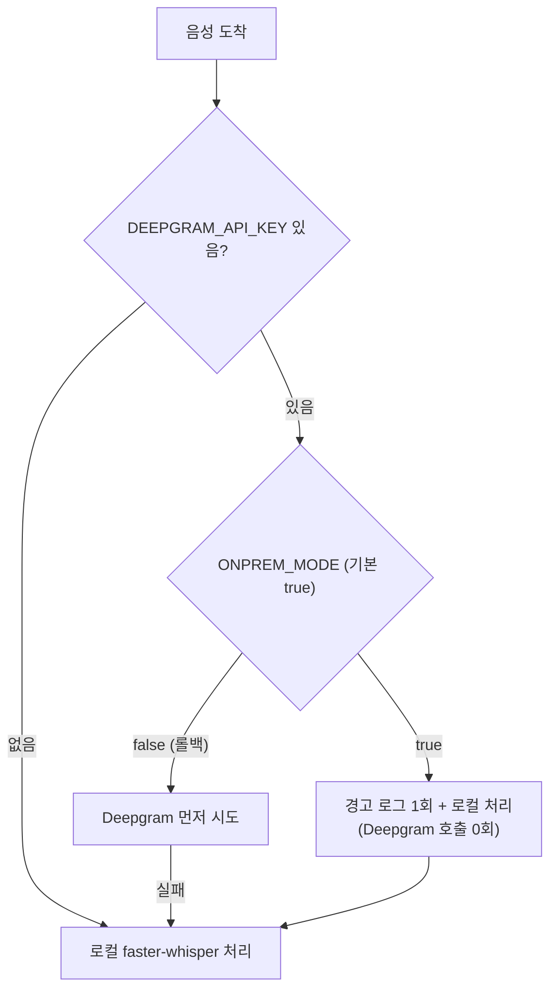

# Deepgram 코드 차단(온프리미스 모드) — 작업 내용 및 내부테스트 결과서

- 작업일: 2026-10-12 / 브랜치: `PROD_SCH` / 요청: 사용자 직접 지시("Deepgram 코드 차단 구현, 로컬 faster-whisper가 처리, 병렬 처리") + "방화벽 아웃바운드 점검에서 SMTP 외부 발송은 처리 제외로 기재"
- 판정: **신규 내부 테스트 13건 통과, 가드 제거 변이 5/5 탐지, 회귀 결과는 6장.** 실제 음성 모델·실제 Deepgram 호출은 이 서버에서 검증 불가(7장).

## 1. 문제와 목표

| 항목 | 내용 |
|---|---|
| 문제 | `DEEPGRAM_API_KEY`가 `.env`/환경변수에 있으면 `stt_router`가 지원자 음성을 외부 Deepgram으로 먼저 전송 → 온프리미스 목적(데이터 외부 미전송)과 충돌 |
| 키 삭제만으로 부족한 이유 | 운영자가 키를 다시 넣거나 다른 환경변수/백업 `.env`에 남아 있으면 외부 전송이 되살아남 |
| 목표 | 키가 있어도 코드가 외부로 보내지 않고, 항상 로컬 faster-whisper가 처리 |

## 2. 변경 내용



| 파일 | 변경 |
|---|---|
| `backend/app/core/config.py` | `onprem_mode: bool = True` (환경변수 `ONPREM_MODE`) |
| `backend/app/services/stt_router.py` | 키가 있어도 온프리미스 모드면 Deepgram 미호출, 프로세스당 1회 경고(키 값은 로그에 남기지 않음) |
| `backend/app/services/stt_adapter_deepgram.py` | 다층 방어: 직접 호출도 네트워크 전에 `SttTranscriptionError`로 거부 |
| `backend/app/services/whiteboard_vision.py` | 같은 방식으로 OpenAI 비전 호출 거부(`VisionAnalysisError`) |
| `backend/app/services/tts_adapter_elevenlabs.py` | 같은 방식으로 ElevenLabs 호출 거부(`TtsSynthesisError`) |
| `backend/.env.example` | `ONPREM_MODE` 설명 추가 |
| `backend/tests/onprem/test_onprem_block.py` (신규) | 테스트 13건 |

설계 결정: ① 기본값을 `true`(차단)로 두어 "실수로 키가 남아도 안전한" 쪽이 기본. ② 롤백은 `ONPREM_MODE=false` 한 줄. ③ **메일(SMTP)은 차단 대상이 아님** — 지원자에게 전달해야 하는 외부 통신이라 사용자 지시에 따라 처리 제외(OP-13이 메일 코드에 이 모드 개입이 없음을 고정).

## 3. 테스트 환경

| 항목 | 값 |
|---|---|
| OS / Python | Linux / 3.11 |
| 가짜로 대체한 것 | faster-whisper·sentence-transformers 등 무거운 패키지(스텁), `urllib.request.urlopen`(네트워크 호출 감시용), STT 로컬/Deepgram 함수(호출 횟수 감시) |
| 진짜를 쓴 것 | `stt_router` 분기 로직, 어댑터의 실제 가드 코드, pydantic `Settings` 로딩(환경변수 해석·검증) |

## 4. 테스트 결과 (13건)

| ID | 시나리오 | 기대 | 결과 |
|---|---|---|---|
| OP-01 | 키 있음 + 온프리미스 | Deepgram 0회, 로컬 1회 | PASS |
| OP-02 | 키 없음 + 온프리미스 | 로컬 처리 | PASS |
| OP-03 | 롤백(`false`) + 키 있음 | Deepgram 먼저, 로컬 0회 | PASS |
| OP-04 | 롤백 + Deepgram 실패 | 로컬로 폴백 | PASS |
| OP-05 | 차단 경고 로그 | 3회 호출해도 1회만, 키 값 미노출 | PASS |
| OP-06 | 키 없을 때 | 경고 없음 | PASS |
| OP-07 | Deepgram 어댑터 직접 호출 | `SttTranscriptionError`, 네트워크 호출 0건 | PASS |
| OP-08 | OpenAI 비전 직접 호출 | `VisionAnalysisError`, 네트워크 호출 0건 | PASS |
| OP-09 | ElevenLabs 직접 호출 | `TtsSynthesisError`, 네트워크 호출 0건 | PASS |
| OP-10 | 롤백 시 어댑터가 실제 네트워크 계층까지 도달 | `api.deepgram.com`, `elevenlabs` 호출 시도 확인(회귀) | PASS |
| OP-11 | 설정 기본값/환경변수 | 기본 `true`, `ONPREM_MODE=false` 적용 | PASS |
| OP-12 | 잘못된 값(`maybe`) | `ValidationError` | PASS |
| OP-13 | 메일 코드 | 온프리미스 모드 참조 없음(차단 대상 아님) | PASS |

## 5. 2차 내부 검증(규칙 B) — 변이 테스트

| 변이 | 내용 | 결과 |
|---|---|---|
| M1 | 라우터의 온프리미스 분기 제거 | 탐지(2건 실패) |
| M2 | Deepgram 어댑터 가드 제거 | 탐지 |
| M3 | OpenAI 비전 어댑터 가드 제거 | 탐지 |
| M4 | ElevenLabs 어댑터 가드 제거 | 탐지 |
| M5 | 기본값을 `false`로 변경 | 탐지 |

변이 후 원본 복원(파일 diff 동일) 및 13건 재통과 확인.

## 6. 회귀

| 대상 | 결과 |
|---|---|
| `tests/turn_graph/test_turn_graph.py` (그래프·LangChain 단위, DB 불필요) | 22건 PASS |
| 앱 전체 import (`app.main`, `app.worker.tasks`) | OK, `onprem_mode=True`, `llm_orchestration=graph` |
| `tests/turn_graph/test_rag_db.py`, `test_turn_job_integration.py`, `final_decision` 메일 테스트 | **이번에 재실행하지 않음** — 실제 PostgreSQL이 필요한데 이 작업에서는 DB를 띄우지 않았다. 변경은 설정 필드 1개 추가와 STT·외부 어댑터 4개 파일의 가드로, 해당 테스트가 다루는 RAG·턴 처리·메일 코드는 건드리지 않았다(메일은 OP-13이 참조 없음을 고정). PC에서 기존 방식대로 실행해 확인 권장 |

## 7. 이 검증에서 확인하지 못한 것 (사용자 PC 확인 필요)

| 미검증 | 이유 | 확인 방법 |
|---|---|---|
| 실제 faster-whisper 모델의 한국어 인식 결과 | 이 서버에서 모델을 받을 수 없음 | PC에서 `.env`에 키를 둔 채로 면접 음성 답변 1회 → 텍스트 변환 정상 여부 |
| 실제 Deepgram 호출이 일어나지 않는지(네트워크 캡처) | 실제 키·네트워크 없음 | 워커 로그에 "ONPREM_MODE로 차단" 경고가 1회 나오고 `Deepgram STT 실패` 로그가 없어야 함. 방화벽 점검(8장)으로 최종 증거 확보 |
| 로컬 인식 품질(정확도·속도) | 실측 불가 | 부족하면 더 큰 Whisper 모델로 상향(별도 작업) |

## 8. 방화벽 아웃바운드 점검 — 처리 제외 사항 (사용자 지시)

| 항목 | 처리 |
|---|---|
| **SMTP(메일) 외부 발송** | **처리 제외.** 지원자에게 가는 안내 메일은 반드시 외부로 나가야 하므로 Gmail 발송을 유지하고, 방화벽 허용 목록에 메일 서버(`smtp.gmail.com:587`)만 예외로 둔다. "사내 SMTP로 교체" 안은 철회. |
| 그 외 아웃바운드 | 차단 후 접속 시도 로그를 점검하며, 메일 서버 외 항목이 보이면 원인 추적 |

## 9. PC 적용

```powershell
git pull origin PROD_SCH
# 서버·워커 재시작 (설정은 시작 시 읽음)
```

- 별도 설치 없음(신규 패키지 없음). `ONPREM_MODE`를 설정하지 않으면 기본 `true`(차단)다.
- 키 정리 권장: `.env`·시스템 환경변수·배포 스크립트의 `DEEPGRAM_API_KEY` 제거, Deepgram 콘솔에서 키 폐기.
- 롤백: `.env`에 `ONPREM_MODE=false` 후 재시작.

## 10. 정리(규칙 K)

임시 가상환경(`.harness-tmp/`)은 작업 종료 시 janitor로 삭제한다. 저장소에는 아티팩트를 남기지 않았다.
