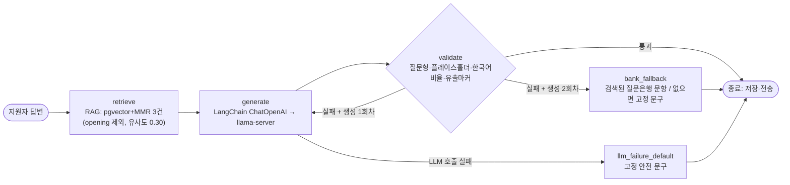

# 랭체인·랭그래프·RAG 운영 적용 — 작업 내용 및 내부테스트 결과서

- 작업일: 2026-10-12 / 브랜치: `PROD_SCH` / 요청: 사용자 직접 지시(면접장 RAG 점검 마무리, 랭체인 운영 연결, 랭그래프로 "재시도·폴백·검증" 분기 구현)
- 판정: **내부 테스트 43건 + 기존 회귀 13건 전부 통과, 변이 검증 5/5 탐지.** 단, 실제 임베딩 모델·실제 llama-server·Windows 로컬 환경 검증은 이 서버에서 불가능해 **미검증**(8장).

## 1. 무엇을 바꿨나

| 구분 | 파일 | 변경 |
|---|---|---|
| 신규 | `backend/app/services/turn_graph.py` | 꼬리질문 처리 LangGraph 그래프 + `QuestionBankRetriever`(LangChain Retriever로 RAG 검색 래핑) |
| 신규 | `backend/app/services/rag_healthcheck.py` | RAG 동작 점검 CLI(`python -m app.services.rag_healthcheck`) |
| 수정 | `backend/app/services/langchain_orchestrator.py` | 운영용 `generate_turn_via_langchain()` 추가, 토큰 상한 키 결함 수정 |
| 수정 | `backend/app/worker/tasks.py` | `process_turn_job`에 그래프 경로 연결(기존 경로는 그대로 유지) |
| 수정 | `backend/app/core/config.py` | `LLM_ORCHESTRATION` 스위치(`graph` 기본 / `legacy` 롤백) |
| 수정 | `backend/requirements.txt` | `langgraph>=1.0,<2.0` |
| 신규 | `backend/tests/turn_graph/` | 테스트 43건 |
| 수정 | `CLAUDE.MD` | 병렬·빠른 개발·15분 무응답 금지 규칙 |

## 2. 구조 (현재 `_generate_validated_followup` 분기를 그대로 그래프로)



| 정책 | 기존 | 그래프 | 동일 여부 |
|---|---|---|---|
| 생성 횟수 | 품질 가드 실패 시 최대 2회 | `MAX_GENERATIONS = 2` | 동일 |
| 파싱 재시도 | 생성 함수 내부 1회(총 2회) | `generate_turn_via_langchain` 내부 1회 | 동일 |
| 가드 실패 → 폴백 | 질문은행 1순위 문항, 없으면 고정 문구 | `bank_fallback` | 동일 |
| LLM 호출 실패 | 고정 문구 + `question_id`는 검색 후보 유지 | `llm_failure_default`, 후보 유지 | 동일 |
| 유출 마커 감사로그 | 실패 때마다 기록 | 실패 때마다 `on_persona_leak` | 동일 |
| 프롬프트 role 분리 | system/user 분리 | `SystemMessage`/`HumanMessage` | 동일 |

설계 결정: 모델이 Qwen2.5 1.5B라 도구 호출 에이전트는 쓰지 않고 순서 고정 그래프만 사용. 체크포인터 미사용(정본은 DB `TRANSCRIPTS`). 롤백은 환경변수 `LLM_ORCHESTRATION=legacy` 한 줄.

## 3. 테스트 환경

| 항목 | 값 |
|---|---|
| OS / Python | Linux / 3.11.15 |
| DB | PostgreSQL 16 + pgvector 0.x(확장 설치 확인), 전용 임시 인스턴스, **alembic v1→v18 전체 마이그레이션 적용(성공)** |
| 패키지 | langgraph 1.0.1, langchain-core 0.3.86, langchain-openai 0.2.14, openai 1.109.1, pydantic 2.14, SQLAlchemy 2.0 |
| 가짜로 대체한 것 | 임베딩 모델(결정적 키워드 임베더), TTS, Redis 발행, 일부 테스트에서 LLM(가짜 llama-server HTTP 포함) |
| 진짜를 쓴 것 | PostgreSQL+pgvector SQL, 코사인 거리·MMR·필터, LangGraph, LangChain Retriever/ChatOpenAI HTTP 요청, Celery 태스크 실행, 필드 암호화(v16) |

## 4. 테스트 결과 (총 43건, 1차 전부 통과)

### 4.1 그래프 분기·LangChain (`test_turn_graph.py`, 22건)

| ID | 시나리오 | 기대 | 결과 |
|---|---|---|---|
| TC-01 | 1회 생성에서 통과 | 노드 순서 retrieve→generate→validate, 생성 1회 | PASS |
| TC-02 | 1차 비질문 → 2차 통과 | 생성 2회, 폴백 없음 | PASS |
| TC-03 ×3 | 재시도 소진(비질문 / 플레이스홀더 / 유출마커) | 질문은행 문항으로 폴백, 3번째 생성 없음 | PASS ×3 |
| TC-04 | 재시도 소진 + 후보 0건 | 고정 문구 | PASS |
| TC-05 | 1회차에서 LLM 호출 실패 | 고정 문구, 후보 유지, validate 미실행 | PASS |
| TC-06 | 재시도 중 LLM 호출 실패 | 고정 문구 | PASS |
| TC-07 | 유출 마커 감사로그 | 실패 때마다 호출 / 일반 실패는 미호출 | PASS |
| TC-08 | 후보가 시스템 프롬프트로 주입 | 프롬프트가 기존 빌더 출력과 일치 | PASS |
| TC-09 ×3 | **기존 `_generate_validated_followup`과 동등성**(통과/재시도/소진) | 출력·control 일치 | PASS ×3 |
| TC-10 | LLM 실패 동등성 | 고정 문구·`next_question` | PASS |
| TC-11~15 | LangChain 생성 함수: 정상 / 파싱 1회 재시도 / 파싱 소진 / 호출 오류(무재시도) / 비문자열 content | 정상 또는 `LlmGenerationError` | PASS ×5 |
| TC-16 | 가짜 llama-server로 **실제 HTTP 요청 형식** | `/v1/chat/completions`, role 분리, JSON 모드, `max_tokens=300`, `max_completion_tokens` 없음 | PASS(결함 수정 후, 5.1) |
| TC-17 | 그래프+LangChain+HTTP 전 구간(1차 무효→재시도 유효) | 서버 2회 호출 | PASS |
| TC-18 | 설정 스위치 검증 | `legacy` 허용, 임의 값 거부, 기본 `graph` | PASS |

### 4.2 RAG 실제 DB (`test_rag_db.py`, 14건)

| ID | 시나리오 | 결과 |
|---|---|---|
| RAG-01 | 빈 질문은행 → 빈 결과 | PASS |
| RAG-02 | 유사도 높은 순 정렬 | PASS |
| RAG-03 | opening 카테고리만 조회 | PASS |
| RAG-04 | 꼬리질문에서 opening 제외 | PASS |
| RAG-05 | 유사도 임계치(0.30)로 무관 질문 제거 | PASS |
| RAG-06 | MMR 중복 억제 | PASS |
| RAG-07 | 후보보다 큰 top_k | PASS |
| RAG-08 | Retriever 래퍼: Document·메타데이터·`last_questions` | PASS |
| RAG-09 | 그래프+실제 DB: `question_id` 연결·프롬프트 주입 | PASS |
| RAG-10 | 그래프+실제 DB: 폴백이 DB 문항 사용 | PASS |
| RAG-11 | 시드 15건 삽입·재실행 멱등(0건) | PASS |
| RAG-12 | 시드 후 첫 질문 선택 | PASS |
| RAG-13 | pgvector 차원(384) 강제 | PASS |
| RAG-14 | 그래프가 opening을 꼬리질문 후보로 쓰지 않음 | PASS(2차 검증에서 추가, 5.2) |

### 4.3 `process_turn_job` 통합 (`test_turn_job_integration.py`, 7건, 그래프/기존 경로 양쪽)

| ID | 시나리오 | 결과 |
|---|---|---|
| JOB-01 ×2 | 정상: AI 턴 저장 + `question_id` 연결 + `turn_result` 발행(오류 이벤트 없음) | PASS ×2 |
| JOB-02 ×2 | LLM 실패: 고정 문구 + `question_id` 유지 + `next_question` | PASS ×2 |
| JOB-03 ×2 | 품질 가드 소진: 질문은행 문항 저장 | PASS ×2 |
| JOB-04 | 기본값이 graph / 종료된 세션은 스킵(기존 동작) | PASS |

### 4.4 회귀

| 대상 | 결과 |
|---|---|
| 기존 `final_decision` 메일 테스트 + 정리 헬퍼 테스트 | 13건 PASS |
| 앱 전체 import (`app.main`, `app.worker.tasks`) | OK, 기본 `graph` |
| alembic v1→v18 (질문은행 pgvector 마이그레이션 v8 포함) | 적용 성공 |

## 5. 발견·수정한 결함 (규칙 F)

### 5.1 DEF-LG-001 — 토큰 상한이 서버에 전달되지 않음 (제품 결함, 수정함)
- 증상: TC-16에서 요청 본문에 `max_tokens`가 없고 `max_completion_tokens`로 전송됨(langchain-openai 0.2.x 동작).
- 영향: llama-server 빌드가 이 키를 무시하면 응답 길이 상한(300)이 풀려 지연·타임아웃 위험.
- 수정: `extra_body={"max_tokens": 300}`로 기존 `llm_engine.py`와 같은 키를 직접 전송. TC-16이 영구 회귀 방지.

### 5.2 TEST-GAP — 변이 검증에서 테스트 구멍 발견 (테스트 결함, 수정함)
- 2차 검증의 변이 5건 중 M5(그래프의 opening 제외 필터 삭제)가 처음엔 통과(탐지 실패).
- 조치: RAG-14 추가 후 재실행하여 탐지 확인.

## 6. 2차 내부 검증 (규칙 B) — 변이 테스트

| 변이 | 내용 | 탐지 |
|---|---|---|
| M1 | 최대 생성 횟수 2→3 | 탐지(실패 1건) |
| M2 | 재시도 소진 시 폴백 제거 | 탐지 |
| M3 | LLM 실패 시 후보 버림 | 탐지 |
| M4 | 유출 감사로그 제거 | 탐지 |
| M5 | opening 제외 필터 제거 | 1차 미탐지 → RAG-14 추가 후 탐지 |

변이 후 원본 복원 확인(파일 diff 동일, 43건 재통과).

## 7. RAG 점검(마무리) 결과

| 점검 | 결과 |
|---|---|
| 검색 SQL(코사인 거리·카테고리·MMR·임계치) | 실제 PostgreSQL에서 정상 |
| 시드 스크립트 | 15건(technical 9 / behavioral 5 / opening 1), 멱등 |
| 질문은행이 비어 있을 때 | **조용히 빈 결과** → 첫 질문이 고정 문구로 대체됨(설계상 정상이나 오인 위험) |
| 대응 | `rag_healthcheck.py` 추가 — 비었거나 임베딩 차원이 틀리면 종료코드 1과 조치 안내 출력. 빈 은행 FAIL(1) → 시드 후 PASS(0) 확인(가짜 임베더 기준) |

## 8. 이 서버에서 검증하지 못한 것 (사용자 PC에서 확인 필요)

| 미검증 | 이유 | 확인 방법 |
|---|---|---|
| 실제 임베딩 모델(MiniLM)의 의미 검색 품질 | 이 서버에서 HuggingFace 접속 차단 | PC에서 `python -m app.services.rag_healthcheck` |
| 실제 llama-server(Qwen 1.5B)와 `max_tokens`·JSON 모드 동작 | Windows 바이너리·모델 파일 없음 | 면접 1회 진행 후 워커 로그의 `followup_graph` 줄 확인 |
| 처리 시간(25초 예산 대비 노드별 소요) | 실제 모델 없음 | 워커 로그의 `followup_graph node=... elapsed_ms=` |
| 질문은행 시드 여부(PC DB) | PC DB 접근 불가 | healthcheck 2번 항목 |

## 9. PC에서 적용하는 순서

```powershell
git pull origin PROD_SCH
cd backend
pip install -r requirements.txt            # langgraph 추가됨
python -m app.services.seed_questions       # 질문은행 15건(이미 있으면 0건 삽입)
python -m app.services.rag_healthcheck      # PASS 확인
# 워커 재시작 후 면접 1회 진행 → 워커 로그에서 followup_graph trace 확인
# 문제 시 즉시 롤백: .env 에 LLM_ORCHESTRATION=legacy 추가 후 워커 재시작
```

- 테스트 실행: 디렉터리를 분리해 실행한다. 기존 `final_decision` 메일 테스트가 `langchain_*`를 스텁으로 대체하므로 **같은 프로세스에서 섞어 실행하면 충돌**한다(`pytest tests/turn_graph` 와 `pytest tests/final_decision` 를 따로).

## 10. 잔여 위험 (정직하게)

- 첫 질문(opening) 선택은 기존 직접 호출 그대로다(그래프·Retriever 미적용). 요청 범위가 꼬리질문 분기였기 때문.
- 리포트 생성은 이번 작업 범위 밖이라 변경하지 않았다.
- 실제 모델 품질·속도는 8장 확인 전까지 보증하지 않는다.

## 11. 정리(규칙 K)

임시 PostgreSQL 인스턴스(`/var/tmp/rag_pg`)와 `.harness-tmp/` 가상환경을 작업 종료 시 삭제했고, 저장소에는 아티팩트를 남기지 않았다.
