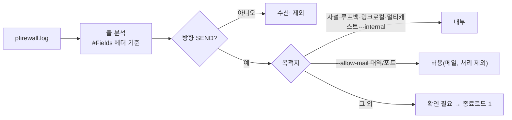

# 방화벽 아웃바운드 점검 도구 및 절차서 — 작업 내용 및 내부테스트 결과서

- 작업일: 2026-10-12 / 브랜치: `PROD_SCH` / 요청: 사용자 지시("방화벽 아웃바운드 점검 — SMTP 외부 발송은 처리 제외", 이어서 진행 상태 질의) 및 계획 승인
- 판정: **분석 도구 테스트 27건 통과, 변이 5/5 탐지.** 단 **실제 Windows 방화벽 설정·실제 로그는 이 서버에서 검증 불가**하며, 방화벽 점검 자체는 사용자 PC에서 수행해야 하는 운영 작업이다(7장).

## 1. 배경과 범위

| 항목 | 내용 |
|---|---|
| 요구 | 서버·클라이언트 방화벽에서 아웃바운드를 차단하고 접속 시도 로그를 점검 (처리 제외: SMTP 메일 외부 발송) |
| 제약 | 방화벽 점검은 사용자 PC/서버의 Windows 설정 변경과 로그 확인이라 클라우드 세션에서 직접 실행 불가 |
| 이번에 한 일 | 사용자가 로그를 눈으로 읽지 않도록 **로그 분석 도구**와 **복사해서 쓰는 절차서**를 제공 |
| 하지 않은 일 | 실제 PC 방화벽 변경, 실제 로그 분석(PC에서 수행) |

## 2. 산출물

| 파일 | 내용 |
|---|---|
| `scripts/onprem/firewall_audit.py` | `pfirewall.log`에서 밖으로 나가는(SEND) 접속을 내부/허용(메일)/확인 필요로 분류. 종료코드 0/1/2. 표준 라이브러리만 사용 |
| `scripts/onprem/tests/test_firewall_audit.py` | 테스트 27건 |
| `docs/onprem/방화벽점검절차.md` | 5단계 절차, Windows 명령어, 경고·롤백, 메일 서버 처리 제외 명시 |

## 3. 테스트 환경

| 항목 | 값 |
|---|---|
| Python | 3.11, pytest (격리 가상환경) |
| 입력 | 공개된 pfirewall.log 형식(`#Fields:` 줄 포함)에 맞춘 **합성 로그** |
| 한계 | 실제 Windows PC에서 생성된 로그로는 검증하지 못함 |

## 4. 테스트 결과 (27건 전부 PASS)

| ID | 시나리오 | 결과 |
|---|---|---|
| FW-01 | 사설·루프백 대역만 → 종료코드 0 | PASS |
| FW-02 | 외부 접속 → 종료코드 1, 목록에 `8.8.8.8:443` 2건 집계 | PASS |
| FW-03 | 메일 서버(대역+포트)만 외부 → 0, 허용(메일) 1건 | PASS |
| FW-04 | 메일 서버 IP의 다른 포트(443) → 1 | PASS |
| FW-05 | 포트 없는 메일 규칙은 모든 포트 허용 | PASS |
| FW-06 | RECEIVE(수신)는 점검 제외 | PASS |
| FW-07 | DROP(차단된 시도)도 보고 | PASS |
| FW-08 | IPv6 로컬(`::1`, `fe80::`, `fd00::`)은 내부, 글로벌은 외부 | PASS |
| FW-09 | 멀티캐스트·브로드캐스트는 내부 | PASS |
| FW-10 | `--internal`로 추가한 대역(100.64.0.0/10)은 내부 | PASS |
| FW-11 | 포트 없는 ICMP | PASS |
| FW-12 | 헤더·빈 줄 무시 | PASS |
| FW-13 | 깨진 줄은 건너뛰고 개수 표시 | PASS |
| FW-14 | 읽을 줄이 전혀 없는 형식 오류 → 2 | PASS |
| FW-15 | 빈 로그 → 2 | PASS |
| FW-16 | 파일 없음 → 2 | PASS |
| FW-17 | 잘못된 `--allow-mail` 값 → 2 | PASS |
| FW-18 | `#Fields:` 줄이 없으면 기본 열 순서 사용 | PASS |
| FW-19 | 횟수 많은 순 정렬 | PASS |
| FW-20 | 한글 경로·UTF-8 로그 | PASS |
| FW-21 ×4 | 메일 규칙 파싱 정상(대역/IP/포트/IPv6) | PASS ×4 |
| FW-22 ×3 | 메일 규칙 파싱 오류(잘못된 IP, 포트 범위 초과, 비숫자 포트) | PASS ×3 |

### 4.1 실제 실행 확인 (CLI, 합성 로그 6줄)
내부 2건, 메일 1건(허용), 확인 필요 2건(`151.101.1.69:443` ALLOW 1·DROP 1), 수신 1건 제외로 정확히 분류되고 종료코드 1. 존재하지 않는 파일은 안내 메시지와 종료코드 2.

## 5. 2차 내부 검증(규칙 B) — 변이 테스트

| 변이 | 내용 | 결과 |
|---|---|---|
| M1 | 내부 대역 판정 제거 | 탐지(8건 실패) |
| M2 | 메일 허용 제거 | 탐지(2건 실패) |
| M3 | 확인 필요가 있어도 종료코드 0 | 탐지(7건 실패) |
| M4 | 수신 방향도 집계 | 탐지 |
| M5 | 메일 규칙의 포트 무시 | 탐지 |

변이 후 원본 복원(diff 동일) 및 27건 재통과 확인.

## 6. 발견 사항

| ID | 내용 | 조치 |
|---|---|---|
| NOTE-01 | 테스트에서 문서용 예약 대역(203.0.113.x)을 "외부" 예로 썼더니 파이썬이 사설로 분류해 FW-10이 실패 | 테스트 IP를 100.64.1.5(CGNAT)로 교체. 도구 동작은 정상. 절차서에 CGNAT 대역은 `--internal`로 추가하도록 명시 |
| NOTE-02 | Gmail 등 메일 서버 IP는 고정이 아니라 방화벽 IP 예외가 어느 날 깨질 수 있음 | 절차서에 위험과 대안(정기 점검, 프록시/릴레이 검토) 기재. 이번 작업에서 결정하지 않음 |

## 7. 이 검증에서 확인하지 못한 것 (사용자 환경)

| 미검증 | 이유 | 확인 방법 |
|---|---|---|
| 실제 Windows 방화벽 명령(`Set-NetFirewallProfile`, `New-NetFirewallRule`)의 동작 | 이 서버는 Linux, Windows 방화벽 없음 | 관리자 PowerShell에서 절차서 2·5단계를 한 줄씩 실행하며 확인 |
| 실제 `pfirewall.log`와 도구의 호환 | 합성 로그로만 검증 | PC에서 첫 실행. 형식이 다르면 종료코드 2와 안내가 나오며, 로그 앞부분을 알려주면 보정 |
| 숨은 외부 접속이 실제로 있는지 | 실제 면접 실행 로그 없음 | 절차서 3~5단계로 서버·클라이언트 각각 점검 |
| 차단 적용 후 서비스 정상 여부 | 실제 환경 없음 | 5단계 통과 기준(전 과정 정상 + 확인 필요 항목 없음) |

## 8. 처리 제외 사항 (사용자 지시)

| 항목 | 처리 |
|---|---|
| **SMTP(메일) 외부 발송** | **처리 제외.** 지원자에게 가는 안내 메일은 외부로 나가야 하므로 Gmail 발송을 유지하고, 방화벽 허용 목록과 `--allow-mail`에 메일 서버만 예외로 둔다. |

## 9. 정리(규칙 K)

임시 가상환경과 합성 로그(`.harness-tmp/`)는 작업 종료 시 janitor로 삭제했다.
