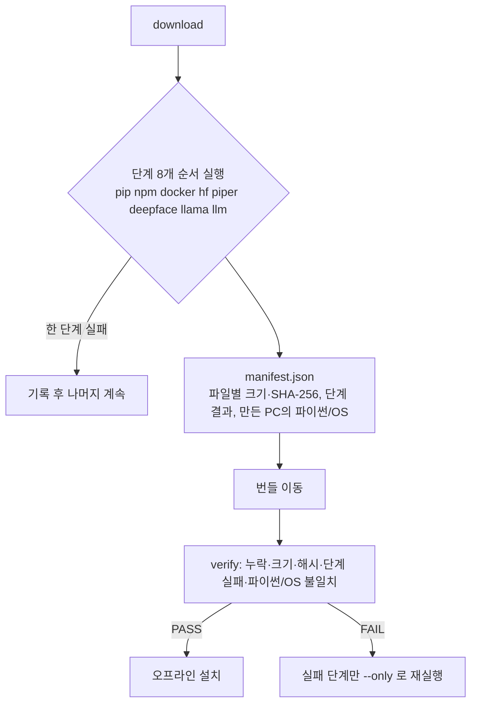

# 설치물 반입 목록 및 다운로드 도구 — 작업 내용 및 내부테스트 결과서

- 작업일: 2026-10-12 / 브랜치: `PROD_SCH` / 요청: 사용자 직접 지시("반입 목록과 다운로드 스크립트 만들어 주세요")
- 판정: **도구 테스트 19건 통과(실제 네트워크 1건 포함), 변이 7/7 탐지.** 단 HuggingFace·GitHub·Docker Hub에서의 **실제 다운로드는 이 서버에서 검증하지 못했다**(6장).

## 1. 배경

| 항목 | 내용 |
|---|---|
| 문제 | 폐쇄망에는 인터넷이 없어, 설치·첫 실행 때 자동으로 받던 부품(패키지, Docker 이미지, AI 모델)이 없으면 멈춘다 |
| 목표 | 인터넷 PC에서 부품을 한 번에 모아 번들로 만들고, 폐쇄망에서 빠짐·손상을 확인한 뒤 설치 |

## 2. 산출물

| 파일 | 내용 |
|---|---|
| `scripts/onprem/prepare_offline_bundle.py` | `list`(반입 목록), `download`(번들 생성, `--only/--skip/--dry-run`), `verify`(무결성 확인) |
| `docs/onprem/설치물반입목록.md` | 반입 목록 표, 번들 만들기·폐쇄망 설치 절차, 환경변수, 설치 후 확인, 미확인 사항 |
| `scripts/onprem/tests/test_prepare_offline_bundle.py` | 테스트 19건 |

반입 대상은 프로젝트 소스에서 확인한 값이다: 파이썬 패키지(`requirements.txt` 전체), 프런트 패키지 2개 앱, Docker 이미지 4종(`compose` 2 + `code_sandbox` 2), Whisper `small`, MiniLM, Piper `ko_KR-kss-medium`, DeepFace 감정 가중치, llama.cpp `b11050` Windows zip 2종, Qwen2.5 1.5B Q4_K_M(1,117,320,736 바이트), SmolVLM 2개 파일.

## 3. 테스트 환경

| 항목 | 값 |
|---|---|
| OS / Python | Linux / 3.11, pytest |
| 가짜로 대체한 것 | 명령 실행기(subprocess), HF·GitHub 다운로더, HF 스냅샷 |
| 진짜를 쓴 것 | 도구의 모든 분기·매니페스트·검증 로직, **실제 네트워크의 pip download·npm ci, 받은 파일로 하는 오프라인 설치(`pip --no-index`, `npm ci --offline`)** |

## 4. 테스트 결과 (19건)

| ID | 시나리오 | 결과 |
|---|---|---|
| BU-01 | `list`가 8개 단계를 모두 출력 | PASS |
| BU-02 | `--dry-run`은 명령 실행 0회, 폴더·파일 생성 0건 | PASS |
| BU-03 | 전체 실행: manifest의 단계 8개 ok, 모든 파일에 sha256(64자), 프로젝트 파일명(`qwen2.5-...gguf`, `smolvlm-...`)으로 배치, 직후 verify PASS | PASS |
| BU-04 | docker 단계 실패해도 나머지 계속, 종료코드 1, verify가 실패 단계를 표시 | PASS |
| BU-05 | `--only docker` 재실행 시 이전 성공 단계 보존·병합, verify PASS | PASS |
| BU-06 | verify: 같은 크기의 내용 변조 → 해시 불일치, 크기 변경 → 크기 불일치, 삭제 → 누락(각각 해당 줄이 출력됨) | PASS |
| BU-07 | manifest 없음/깨짐 → 종료코드 2 | PASS |
| BU-08 | 알 수 없는 단계 이름 → 종료코드 2와 안내 | PASS |
| BU-09 | pip: 휠만 모드 실패 시 소스 배포본 허용으로 재시도, pip/setuptools/wheel도 함께 | PASS |
| BU-10 | npm: 두 앱 각각 `npm ci`, 같은 캐시 공유, `--ignore-scripts` | PASS |
| BU-11 | docker: 4개 이미지를 `linux/amd64`로 pull, `save`는 1회 | PASS |
| BU-12 | HF 모델: 변환본(onnx/openvino 등) 제외 패턴 전달, MiniLM 저장 확인 | PASS |
| BU-13 | piper: 모듈 실패 시 HF 직접 받기로 전환, 하위 폴더 구조를 평평하게 정리 | PASS |
| BU-14 | LLM 모델: 크기 확인, SmolVLM을 프로젝트 파일명으로 변경 | PASS |
| BU-15 | Qwen 크기가 다르면 해당 단계 실패 | PASS |
| BU-16 | DeepFace 단계가 `DEEPFACE_HOME` 환경변수를 지정 | PASS |
| BU-17 | 만든 PC와 파이썬/OS가 다르면 verify가 경고 | PASS |
| BU-18 | **드리프트 검사**: 도구의 상수(Qwen·SmolVLM 파일명, Piper 음성, MiniLM, Whisper small, Docker 이미지 4종)가 프로젝트 소스와 일치 | PASS |
| BU-19 | **실제 네트워크**: PyPI·npm 레지스트리에서 실제로 받고, 받은 휠로 `pip --no-index` 설치, 받은 캐시로 `npm ci --offline` 설치 성공 | PASS (약 86초, 네트워크 필요) |

## 5. 2차 내부 검증(규칙 B) — 변이 테스트

| 변이 | 내용 | 결과 |
|---|---|---|
| M1 | 해시를 고정값으로 | 탐지 |
| M2 | 단계 실패 격리 제거 | 탐지(2건) |
| M3 | 크기 검사 제거 | **1차 미탐지** → 테스트가 "크기 불일치" 문구를 요약 줄로 잘못 만족하고 있었음. 해당 줄 단위 단언으로 보강 후 탐지 |
| M4 | Docker 플랫폼 지정 제거 | 탐지 |
| M5 | 이전 단계 결과 병합 제거 | 탐지 |
| M6 | Qwen 크기 검사 제거 | 탐지 |
| M7 | 누락 검사 제거 | 탐지 |

변이 후 원본 복원(diff 동일) 및 재통과 확인.

## 6. 이 검증에서 확인하지 못한 것 (사용자 환경)

| 미검증 | 이유 | 확인 방법 |
|---|---|---|
| HuggingFace·GitHub·Docker Hub에서 실제 다운로드 | 이 서버는 HuggingFace 접속이 차단되고 Docker 데몬이 없음 | 인터넷 PC에서 `download --dry-run` 후 `download` 실행, 실패 단계는 `--only`로 재시도 |
| SmolVLM 저장소/파일명 | 프로젝트 문서에 출처가 없어 일반 지식 기준 | 실패 시 현재 PC의 `backend\var\llm\models\` 파일을 그대로 복사 |
| Piper 직접 받기 경로, DeepFace 가중치 저장 위치 | 폴백 경로·라이브러리 동작 미실행 | 인터넷 PC 실행 결과의 manifest 확인 |
| `HF_HUB_OFFLINE` 상태에서의 실제 모델 로드 | 모델을 받을 수 없어 로드 불가 | 폐쇄망에서 `rag_healthcheck`와 음성 답변 1회 |
| 번들 크기·소요 시간 | 실측 불가 | 첫 실행 때 확인(모델·이미지로 수 GB 예상) |
| 모델 라이선스 | 원문 미확인 | 도입 전 확인 |

## 7. 발견 사항

| ID | 내용 | 조치 |
|---|---|---|
| FIND-01 | 테스트가 가짜 Qwen 파일을 1.1GB로 만들어 느림(1회 15~50초) | 기대 크기를 테스트에서만 64바이트로 교체(크기 검사 로직은 그대로 검증) → 4.7초 |
| FIND-02 | 변이 M3 미탐지(테스트 구멍) | 줄 단위 단언으로 보강 |
| FIND-03 | dry-run 출력이 "완료"로 표시돼 실행한 것처럼 보임 | "예정(dry-run, 실행하지 않음)"으로 수정 |
| NOTE-01 | `HF_HUB_CACHE`·`HF_HUB_OFFLINE`·`DEEPFACE_HOME`은 `.env`가 아니라 OS 환경변수여야 라이브러리가 읽음 | 반입 문서에 명시 |

## 8. 정리(규칙 K)

임시 가상환경·합성 번들은 작업 종료 시 janitor로 삭제했다. 변이 검증 중 중단된 작업이 있었으나 백업으로 원본을 복구하고 핵심 줄을 확인한 뒤 변이 검증을 처음부터 다시 수행했다.
