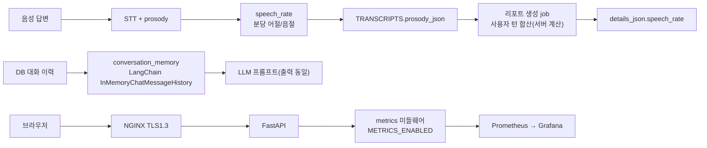

# 원본 계획서 스펙 반영 — "소프트웨어만으로 가능" 8개 항목 작업 내용 및 내부테스트 결과서

- 작업일: 2026-10-12 / 브랜치: `PROD_SCH` / 요청: 사용자 직접 지시("A. 소프트웨어만으로 가능 중 항목당 5분 이내로 되는 것만 수정, 병렬 처리")
- 판정: **신규 테스트 약 85건 + 렌더 확인 1건 통과, 변이 6/6 탐지, 기존 회귀(백엔드 서비스·DB·메일·도구) 통과.** 단 GitHub 러너 실행, Prometheus/Grafana 컨테이너 기동, 실제 음성 E2E는 이 서버에서 검증하지 못했다(7장).

## 1. 범위 결정

| 항목 | 처리 | 이유 |
|---|---|---|
| 발화 속도 지표 | **반영** | 5분 이내 |
| LangChain Memory | **반영** | 5분 이내 |
| 대시보드 차트(Recharts) | **반영** | 5분 이내 |
| NGINX 게이트웨이 + TLS 1.3 | **반영** | 5분 이내 |
| Prometheus/Grafana | **반영(API 프로세스 지표)** | 워커 지표는 제외(아래) |
| CI/CD | **반영(CI까지, CD 제외)** | 배포는 승인 없이 실행 금지 규칙 |
| Model Card | **반영** | 5분 이내 |
| Locust 부하 테스트 스크립트 | **반영(읽기 전용 시나리오)** | 5분 이내 |
| 코드 AI 분석·언어 확장 | **제외** | 약 1~2주 규모, 5분 초과 |
| 질문 은행 수천 개 | **제외** | 사람의 검수가 필요, 5분 초과 |



## 2. 항목별 변경

| 항목 | 변경 파일 | 핵심 설계 |
|---|---|---|
| 발화 속도 | `app/services/speech_rate.py`(신규), `interviews.py`·`tasks.py` 연결 | DB 컬럼 추가 없이 기존 `prosody_json`에 저장. 분당 어절·음절, 녹음 전체 길이(휴지 포함) 기준, 1초 미만은 계산 안 함, 리포트는 길이 가중 합산을 **서버가 직접 계산**(LLM 값 아님) |
| LangChain Memory | `app/services/conversation_memory.py`(신규), `tasks.py` | `InMemoryChatMessageHistory`로 최근 8턴 구성. **출력 문자열이 기존과 동일**해 프롬프트·품질 가드·폴백 영향 없음. 요약 메모리는 1.5B 모델 위험으로 미적용 |
| 차트 | `frontend/components/ReportCharts.tsx`, `lib/reportStats.ts`, `app/recruiter/page.tsx`, `recharts 3.10.1` | 면접 상태 분포, 종합 점수 분포(4구간). 추가 API 호출 없음, 접근성 요약(aria-label) 포함 |
| NGINX | `deploy/nginx/nginx.conf`, `gen-selfsigned.sh`, `README.md` | TLS 1.3 전용, HTTP→HTTPS, API/WebSocket/화면 프록시, 업로드 상한(음성 26MB, 이력서 12MB), 보안 헤더, `/metrics` 외부 차단 |
| 모니터링 | `app/core/metrics.py`(신규), `main.py`, `config.py`, `deploy/monitoring/*` | 기본 **꺼짐**(`METRICS_ENABLED`), 요청 수·지연·상태코드를 라우트 템플릿으로 집계, Prometheus·Grafana 설정과 대시보드 |
| CI | `.github/workflows/ci.yml` | backend(DB 포함)/tooling/frontend 3개 job, 배포 없음, 최소 권한 |
| Model Card | `docs/model-card.md` | 운영 모델 6종, 차단된 외부 AI 3종, 한계·미평가·라이선스 미확인 명시 |
| Locust | `loadtest/locustfile.py`, `stub_server.py` | 로그인·내 정보·목록 조회만(쓰기 요청 없음), 계정 CSV 순환 |

## 3. 테스트 환경

| 항목 | 값 |
|---|---|
| OS / Python / Node | Linux / 3.11 / 22.22 |
| 진짜로 실행한 것 | PostgreSQL 16+pgvector(마이그레이션 전체), **실제 nginx 1.24**, **실제 Locust**, Chromium(Playwright), Next.js 개발·운영 빌드 |
| 가짜로 대체한 것 | 무거운 AI 패키지(스텁), 가짜 upstream·가짜 API(NGINX·Locust 대상) |

## 4. 테스트 결과

| 대상 | 건수 | 결과 | 주요 검증 |
|---|---|---|---|
| 발화 속도(`test_speech_rate`) | 포함 | PASS | 어절·음절 계산, 1초 경계, NaN·bool·None·빈 텍스트, 원본 불변, 예외 비전파, 길이 가중 합산(단순 평균과 다름) |
| LangChain 메모리(`test_conversation_memory`) | 포함 | PASS | **기존 방식과 출력 동일**(기본·긴 문장·무작위 50회), 창 크기, LangChain 실제 메시지 타입, 상태 비공유 |
| 지표(`test_metrics`) | 포함 | PASS | 기본 꺼짐, 라우트 템플릿 라벨, 오류코드, unmatched 라벨 통합, `/metrics` 자기 제외, 레지스트리 독립 |
| 배선(`test_wiring`) | 포함 | PASS | 실제 `app.main`·`interviews`·`tasks` 모듈 import, 연결 순서, 사용자 턴만 합산 |
| **위 4개 합계** | **45** | PASS | |
| NGINX 실구동(`test_nginx_e2e`) | 13 | PASS | `-t` 통과, **TLS1.3 협상**, **TLS1.2 거부**, 80→443 301, 화면/API 라우팅·`X-Forwarded-Proto`, 두 도메인, `/metrics` 404, 보안 헤더, 버전 숨김, 업로드 25MB 통과·27MB 413·이력서 11MB 통과·13MB 413, **WebSocket 101**, 인증서 SAN·키 권한 600 |
| 모니터링 설정(`test_monitoring_config`) | 6 | PASS | YAML/JSON 문법, 마운트 파일 존재, 127.0.0.1 바인딩, 대시보드 지표 이름이 **실제 `/metrics` 출력에 존재** |
| CI 정적(`test_ci_workflow`) | 7 | PASS | 3개 job, 배포 없음, 액션 버전 고정, 참조 경로 존재, pgvector→마이그레이션→DB 테스트 순서 |
| Locust(`test_locust_run`) | 8 | PASS | 실제 실행 0 실패, 채용담당자 시나리오, 서버 오류·로그인 실패를 실패로 집계(종료코드 1), 자격 증명 누락 메시지, CSV 파싱, 읽기 전용 |
| 프런트 통계(`reportStats.test.mjs`) | 5 | PASS | 상태 순서·미지의 상태, 점수 경계 1~5, null·범위 밖 |
| 차트 렌더(Playwright) | 1 | PASS | 막대 4·3개(값 0은 미표시가 정상), 접근성 요약, 점수 없음 안내, 빈 목록 미표시, 380px 가로 스크롤 없음, 콘솔 오류 0 |
| 프런트 `tsc`, `next build` | - | PASS | `/recruiter` 포함 빌드 성공 |

### 4.1 CI와 같은 명령을 개발 서버에서 순서대로 실행
| CI 단계 | 결과 |
|---|---|
| DB 준비(pgvector + alembic upgrade head) | 성공 |
| `tests/feature_a tests/onprem` | 58 PASS |
| `tests/turn_graph`(DB 필요) | 43 PASS |
| `tests/final_decision/test_final_decision_mail.py`(별도 프로세스) | 6 PASS |
| `scripts/onprem/tests -k "not bu19"` | 45 PASS |
| `deploy/tests`, `loadtest/tests` | 26, 8 PASS |

## 5. 2차 내부 검증(규칙 B) — 변이 테스트

| 변이 | 결과 |
|---|---|
| M1 발화 속도 최소 길이 검사 제거 | 탐지(5건 실패) |
| M2 합산을 단순 평균으로 | 탐지 |
| M3 메모리 창 제거 | 탐지 |
| M4 지표 라벨을 실제 경로로 | 탐지(3건) |
| M5 점수 5점 구간 처리 제거 | 탐지 |
| M6 NGINX에 TLS1.2 허용 | 탐지 |

변이 후 원본 복원(diff 동일), 재통과 확인.

## 6. 발견·수정 사항(규칙 F)

| ID | 내용 | 조치 |
|---|---|---|
| FIND-01 | 테스트 기대값 오계산 2건(음절 수, 어절/분) | 코드가 아닌 테스트 수정 |
| FIND-02 | Locust를 pytest 프로세스에서 import하면 gevent 몽키패치와 ssl이 충돌(RecursionError) | 테스트에서 별도 프로세스로 분리 |
| FIND-03 | `ci.yml`의 "deploy 금지" 정적 검사가 폴더 경로(`deploy/tests`)를 오탐 | 경로를 제외하고 검사하도록 수정 |
| FIND-04 | 프런트 테스트가 `.ts` 확장자 import 때문에 `tsc` 오류 | `.mjs`로 변경(CI 경로 갱신) |
| FIND-05 | 차트 검증 기대값 오류(값 0은 막대가 없음) | 기대값 수정 후 재검증 |
| **FIND-06** | **내 실수:** ruff 포맷을 `app/services` 전체에 실행해 **기존 파일 26개 모양이 바뀜** | 즉시 `git checkout`으로 원복, 내 파일 2개의 필요한 수정만 재적용. 결과: 의도하지 않은 변경 없음 확인 |
| NOTE-01 | 이번 작업 중 이전 작업물(`scripts/onprem`, `tests/turn_graph`)의 코드 스타일 위반도 함께 정리(동작 불변, 테스트 재통과) | 포맷만 변경 |
| NOTE-02 | 기존 위반 3건(`recruiter_resumes.py`, `resumes.py`)은 이번 범위가 아니라 손대지 않음 | CI ruff는 경고로 시작 |

## 7. 이 검증에서 확인하지 못한 것 (정직하게)

| 미검증 | 이유 | 확인 방법 |
|---|---|---|
| GitHub Actions 실제 실행, 파이썬 3.13 의존성 설치 | 러너 없음(로컬 3.11로 같은 명령만 검증) | 푸시 후 첫 실행 결과 확인 |
| Prometheus/Grafana 컨테이너 기동 | 도커 데몬 없음 | `deploy/monitoring/README.md` 순서로 기동 후 대시보드 확인 |
| Windows NGINX 빌드, 실제 브라우저 HSTS·쿠키 | Linux nginx로만 검증 | PC에서 `nginx -t` 및 접속 확인 |
| 발화 속도의 **실제 음성 E2E**(STT→저장→리포트) | 음성 모델·로그인 흐름 없음. 순수 로직·연결 순서만 검증 | PC에서 음성 답변 1회 후 DB의 `prosody_json`, 리포트 `details_json.speech_rate` 확인 |
| 발화 속도·차트의 **화면 표시** | 발화 속도는 데이터까지만 저장하고 화면에는 표시하지 않음(별도 결정 필요). 차트는 샘플 데이터로 렌더 확인 | 로그인한 채용담당자 화면 확인 |
| LangChain Memory가 LLM 품질에 주는 영향 | 출력이 동일하게 설계돼 변화 없음이 목표. 실제 모델 비교 안 함 | - |
| Locust 의미 있는 용량 결과 | 가짜 서버로 스크립트 동작만 확인 | 실제 서버에서 실행 |

## 8. 착수 전 결정이 필요한 것 (임의로 정하지 않음)
1. NGINX 도메인 이름·인증서(자체서명은 시험용), HTTPS 전환 시 프런트 환경변수·CORS·쿠키 설정(`deploy/nginx/README.md`)
2. 발화 속도를 리포트 화면에 어떻게 보여줄지
3. 워커(LLM) 지표를 어떻게 노출할지

## 9. PC 적용
```powershell
git pull origin PROD_SCH
cd backend; pip install -r requirements.txt        # prometheus-client 추가
cd ..\frontend; npm install                         # recharts 추가
```
- 지표는 기본 꺼짐: 켜려면 `METRICS_ENABLED=true` 후 API 재시작.
- 롤백: 모두 코드 변경 최소 단위이며 기존 동작을 바꾸지 않는 방식(메모리는 출력 동일, 지표는 기본 꺼짐).

## 10. 정리(규칙 K)
임시 가상환경·PostgreSQL 인스턴스·임시 검증 페이지·변이 백업을 삭제했다.
