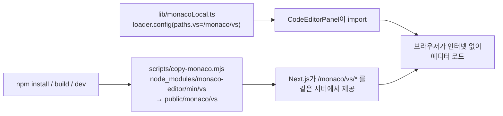

# 코드 에디터(Monaco) 로컬화 — 작업 내용 및 내부테스트 결과서

- 작업일: 2026-10-12 / 브랜치: `PROD_SCH` / 요청: 사용자 승인("이 방식으로 구현") — 온프리미스/폐쇄망에서 면접장 코드 에디터가 뜨도록 CDN 의존 제거
- 판정: **내부 테스트 13건 전부 통과(개발 서버·운영 빌드·실제 컴포넌트), 음성 대조군으로 기존 결함 재현 확인.** 미검증 항목은 7장.

## 1. 문제와 원인

| 항목 | 내용 |
|---|---|
| 증상(예상) | 인터넷이 없는 PC에서 면접장 코드 에디터가 로딩 상태에서 멈춤 |
| 원인 | `@monaco-editor/react` 기본값이 에디터 본체를 `https://cdn.jsdelivr.net/npm/monaco-editor@0.55.1/min/vs`에서 받아옴. 프로젝트에 로컬 경로 설정이 없었음 |
| 재현 | 대조군 페이지(설정 없음)에 인터넷을 막고 접속 → `cdn.jsdelivr.net/.../loader.js` 요청이 발생하고 에디터 미표시(B1, B2) |

## 2. 변경 내용



| 파일 | 변경 |
|---|---|
| `frontend/package.json` | `monaco-editor` 0.55.1을 **정확한 버전으로 선언**(기존 CDN 기본 버전과 동일), `postinstall`·`predev`·`prebuild`에 복사 스크립트 연결 |
| `frontend/package-lock.json` | 위 선언에 따른 잠금 갱신(기존에는 0.56.0이 peer 자동 설치로 들어와 있었음) |
| `frontend/scripts/copy-monaco.mjs` (신규) | 에디터 본체 복사 + 필수 파일(`loader.js`, `editor/editor.main.js`) 존재 검증, 실패 시 종료코드 1 |
| `frontend/lib/monacoLocal.ts` (신규) | `loader.config({ paths: { vs: "/monaco/vs" } })` |
| `frontend/app/interviews/[id]/components/CodeEditorPanel.tsx` | 위 모듈 import 1줄 |
| `.gitignore` | `frontend/public/monaco/`(재생성 가능한 복사본 16MB, 저장소 제외) |

설계 결정: 번들러에 에디터를 넣는 방식은 Next.js 16에서 worker 설정이 까다로워 채택하지 않고, 정적 복사 + 경로 지정 방식을 택했다. 버전은 CDN 기본값(0.55.1)과 동일하게 고정해 에디터 동작 변화를 막았다.

## 3. 테스트 환경

| 항목 | 값 |
|---|---|
| Node / npm | v22.22.0 / 10.9.4 |
| Next.js / React | 16.3.5 / 19.3.0 |
| 브라우저 | Chromium(Playwright), **외부 도메인 요청을 전부 차단**(localhost만 허용) |
| 검증 대상 | ① 적용 모듈을 쓰는 임시 페이지 ② 설정 없는 대조군 페이지 ③ 실제 `CodeEditorPanel` 컴포넌트 |
| 서버 모드 | 개발 서버(`next dev`) 및 운영 빌드(`next build` + `next start`) 양쪽 |

## 4. 테스트 결과

### 4.1 개발 서버 / 운영 빌드 (각 10건, 동일 결과)

| ID | 시나리오 | 기대 | 결과 |
|---|---|---|---|
| A1 | 인터넷 차단 상태에서 에디터 마운트 | `.monaco-editor` 표시 | PASS |
| A2 | 외부 도메인 요청 | 0건 | PASS |
| A3 | `/monaco/vs/*` 자원 응답 | 17건 전부 200 | PASS |
| A4 | `loader.js`, `editor/editor.main` 로드 | 둘 다 로드 | PASS |
| A5 | 코드 입력 | 입력값 `x = 1` 반영 | PASS |
| A6 | 언어 전환 | python → javascript | PASS |
| A7 | 구문 하이라이트(토크나이저) | 토큰 8개 | PASS |
| A8 | python 언어 지원 파일 | 200 | PASS |
| B1 | **대조군**: 설정 없을 때 | `cdn.jsdelivr.net` 요청 발생 | PASS (기존 결함 재현) |
| B2 | **대조군**: 인터넷 차단 시 | 에디터 미표시 | PASS (기존 결함 재현) |

### 4.2 실제 컴포넌트 (`CodeEditorPanel`)

| ID | 시나리오 | 결과 |
|---|---|---|
| C1 | 인터넷 차단 상태에서 에디터 마운트, 외부 요청 0건, 언어 드롭다운 11종(python, javascript, typescript, java, c, cpp, csharp, go, rust, sql, plaintext) 표시 | PASS |

### 4.3 빌드·정적 검사

| 항목 | 결과 |
|---|---|
| `npm run build` | 성공. `prebuild`가 복사를 자동 수행(삭제 후 재생성 확인) |
| `tsc --noEmit` | 오류 0건(e2e 폴더 제외) |
| `eslint`(변경 파일) | `monacoLocal.ts`, `copy-monaco.mjs`: 오류 없음. `CodeEditorPanel.tsx` 155행 `react-hooks/set-state-in-effect` 1건은 **이번 변경과 무관한 기존 코드**(변경은 import 1줄) |
| 복사본 git 제외 | `git check-ignore`로 `public/monaco/` 제외 확인 |

## 5. 2차 내부 검증(규칙 B)

| 확인 | 방법 | 결과 |
|---|---|---|
| 테스트가 결함을 잡는가 | 대조군(설정 제거 상태)에서 동일 검사를 실행 | CDN 요청 발생·에디터 미표시로 **실패를 정확히 재현** |
| 환경 간 일관성 | 개발 서버와 운영 빌드에서 같은 10건 | 양쪽 모두 10/10 |
| 실제 코드 경로 | 임시 페이지가 아니라 실제 `CodeEditorPanel`로 재확인 | 통과 |
| 복사 스크립트 안전성 | `public/monaco`를 지운 뒤 빌드 | 자동 재생성, 필수 파일 검증 통과 |

## 6. 발견 사항

| ID | 내용 | 조치 |
|---|---|---|
| NOTE-01 | 개발 서버는 `127.0.0.1`로 접속하면 HMR 요청을 차단해 화면이 hydration되지 않음(테스트 접속 주소를 `localhost`로 변경). 제품 결함 아님 | 기록만 |
| NOTE-02 | 기존에는 `monaco-editor`가 peer 의존성으로 0.56.0이 자동 설치돼 있었고, 실제 화면은 CDN의 0.55.1을 썼음(버전 불일치) | 0.55.1로 정확히 고정해 해소 |

## 7. 이 검증에서 확인하지 못한 것 (사용자 PC 확인 필요)

| 미검증 | 이유 | 확인 방법 |
|---|---|---|
| 실제 면접 흐름 속 에디터(로그인, 라이브 면접, 코드 제출·실행) | 백엔드·로그인 연동 E2E는 이 서버에서 실행하지 않음. 에디터 로딩 계층만 검증 | PC에서 `git pull` 후 `cd frontend && npm install` → 면접장 코드 화면에서 인터넷 차단 상태로 에디터 확인 |
| 기존 E2E(`frontend/e2e/unit-20`) 회귀 | 백엔드·DB 필요 | PC에서 기존 방식대로 실행 |
| 폰트·이미지 등 Monaco 외 외부 자원 | 소스 확인에서는 없었으나 실제 접속 캡처는 안 함 | 인터넷 차단 상태로 전체 화면 순회 |

## 8. PC 적용 순서

```powershell
git pull origin PROD_SCH
cd frontend
npm install          # postinstall 이 public/monaco/vs 를 자동 생성
npm run dev          # 또는 build/start (predev/prebuild 가 복사를 다시 보장)
```

- 폐쇄망 서버에 배포할 때도 `npm install`(또는 빌드)을 한 번 수행하면 에디터 파일이 같이 준비된다. `node_modules`를 통째로 반입하는 경우에는 `node scripts/copy-monaco.mjs`를 한 번 실행한다.
- 롤백: `CodeEditorPanel.tsx`의 `monacoLocal` import 1줄을 제거하면 기존(CDN) 동작으로 돌아간다.

## 9. 정리(규칙 K)

임시 검증 페이지 3개, 임시 스크립트 2개, 테스트용 서버(3055·3056·3057) 정리 완료. 저장소에는 아티팩트를 남기지 않았다(`tsconfig.tsbuildinfo` 변경도 되돌림).
